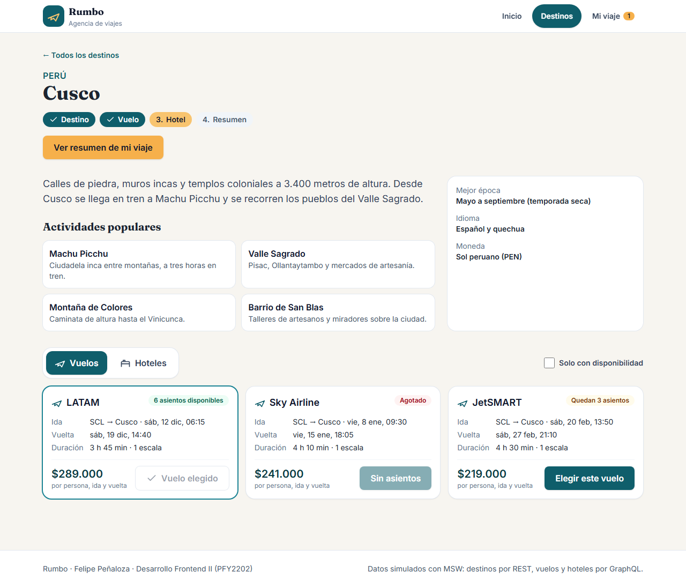

# Rumbo · Agencia de viajes

**Actividad sumativa 2: "Integrando nuestro frontend con backend"**, Desarrollo Frontend II (PFY2202), semana 5.
Autor: Felipe Peñaloza.

| | |
| :--- | :--- |
| **Sitio publicado (GitHub Pages)** | <https://xhellex.github.io/viajes-felipe-penaloza-pfy2202/> |
| **Repositorio** | <https://github.com/xHellex/viajes-felipe-penaloza-pfy2202> |

Rumbo es una aplicación React para planificar un viaje:

- los **destinos** llegan desde una **API REST mock**, con su país y sus actividades populares;
- los **vuelos y hoteles** de cada destino llegan desde una **API GraphQL mock**, con precios, fechas y disponibilidad;
- el usuario elige un destino, compara sus opciones y arma su viaje en **Mi viaje**.

Las dos APIs son simuladas con **MSW** (Mock Service Worker). Funcionan también en el sitio publicado, así que se puede revisar sin instalar nada.



---

## Recorrido de uso (5 pasos)

1. **Destinos** (`/destinos`): se listan los 8 destinos. Se puede filtrar por continente (el filtro se resuelve en la API) y buscar por nombre o país.
2. **Elegir un destino**: abre `/destinos/cusco/vuelos`. Arriba está la información del destino (REST) y abajo las pestañas **Vuelos** y **Hoteles** (GraphQL).
3. **Comparar vuelos**: cada tarjeta muestra la aerolínea, las fechas y horas, la duración, las escalas, el precio y los asientos disponibles. **Solo con disponibilidad** oculta los agotados.
4. **Elegir hotel**: estrellas, precio por noche, fechas disponibles, habitaciones y servicios.
5. **Mi viaje** (`/mi-viaje`): muestra el resumen, las noches calculadas desde el vuelo y el **total** (vuelo + noches de hotel). El plan se guarda en el navegador.

---

## Cómo ejecutar el proyecto

Requisitos: **Node 20.19+ o 22.12+** (desarrollado con Node 22).

```bash
npm install
npm run dev        # http://localhost:5173 con las APIs mock activas
npm test           # pruebas unitarias (Vitest): 51 pruebas
npm run lint       # ESLint
npm run build      # build de producción + copia de 404.html
npx playwright install   # solo la primera vez: descarga Chromium, Firefox y WebKit
npm run e2e        # pruebas en navegadores (Playwright): 17 escenarios × 5 navegadores
```

`npm run e2e` compila el sitio con la misma base que GitHub Pages (`/viajes-felipe-penaloza-pfy2202/`) y lo prueba con `vite preview`. El informe queda en `playwright-report/` (`npx playwright show-report`).

---

## Arquitectura

```text
PaginaDestinos ── useDestinos() ───────── GET  api/destinos ──────┐
PaginaDestino  ── useDestino(id) ──────── GET  api/destinos/:id ──┤
                                                                  ├─▶ Service Worker de MSW
Pestañas Vuelos/Hoteles ── useOpcionesViaje(id) ── Apollo useQuery ┘     ├─ mocks/handlers/rest.js
                           POST graphql   query OpcionesViaje              └─ mocks/handlers/graphql.js
```

**El mismo id del destino** (por ejemplo `cusco`) se usa en la URL, en REST y como variable de GraphQL. Una prueba comprueba que **todo destino del REST tiene vuelos y hoteles en GraphQL** (`src/mocks/handlers/graphql.test.js`).

### API REST (destinos)

| Petición | Respuesta |
| :--- | :--- |
| `GET api/destinos` | `200` con 8 destinos: `{ id, nombre, pais, continente, resumen, actividades: [3 nombres], precioDesde }` |
| `GET api/destinos?continente=Asia` | `200` filtrado en el servidor |
| `GET api/destinos?continente=África` | `200 []`: estado vacío |
| `GET api/destinos/cusco` | `200` con `{ ..., descripcion, actividades: [{ nombre, descripcion }], mejorEpoca, idioma, moneda }` |
| `GET api/destinos/no-existe` | `404 { mensaje }` |

Ejemplo: `GET api/destinos?continente=Asia`

```json
[{ "id": "tokio", "nombre": "Tokio", "pais": "Japón", "continente": "Asia",
   "actividades": ["Templo Senso-ji", "Cruce de Shibuya", "Mercado de Tsukiji"], "precioDesde": 1450000 }]
```

### API GraphQL (vuelos y hoteles)

Esquema (MSW no lo valida, pero es el contrato que respetan el mock y la app):

```graphql
type Query {
  opcionesViaje(destinoId: ID!, soloDisponibles: Boolean = false): OpcionesViaje   # null si el destino no existe
}
type OpcionesViaje { destino: DestinoResumen!  vuelos: [Vuelo!]!  hoteles: [Hotel!]! }
type DestinoResumen { id: ID!  nombre: String!  pais: String! }
type Vuelo {
  id: ID!  destinoId: ID!  aerolinea: String!  origen: String!
  salida: String!  regreso: String!          # ISO 8601 con zona horaria
  duracionMinutos: Int!  escalas: Int!  precio: Int!  asientosDisponibles: Int!
}
type Hotel {
  id: ID!  destinoId: ID!  nombre: String!  estrellas: Int!  precioNoche: Int!
  disponibleDesde: String!  disponibleHasta: String!  habitacionesDisponibles: Int!  servicios: [String!]!
}
```

La app pide **vuelos y hoteles en una sola consulta**, con los campos justos que muestra (`src/services/graphql/operaciones.js`):

```json
POST graphql
{ "operationName": "OpcionesViaje",
  "variables": { "destinoId": "cusco", "soloDisponibles": false },
  "query": "query OpcionesViaje($destinoId: ID!, $soloDisponibles: Boolean) { opcionesViaje(...) { destino { id nombre pais } vuelos { ... } hoteles { ... } } }" }
```

```json
{ "data": { "opcionesViaje": {
  "destino": { "id": "cusco", "nombre": "Cusco", "pais": "Perú" },
  "vuelos": [{ "id": "v-cus-1", "destinoId": "cusco", "aerolinea": "LATAM", "salida": "2026-12-12T06:15:00-03:00",
               "regreso": "2026-12-19T14:40:00-03:00", "precio": 289000, "asientosDisponibles": 6, "...": "..." }],
  "hoteles": [{ "id": "h-cus-1", "destinoId": "cusco", "nombre": "Casa Andina San Blas", "precioNoche": 68000,
                "habitacionesDisponibles": 5, "...": "..." }] } } }
```

Las pestañas **Vuelos** y **Hoteles** usan la misma consulta con las mismas variables: al cambiar de pestaña responde la **caché de Apollo**, sin una nueva petición (lo comprueba el e2e 5). **Solo con disponibilidad** cambia la variable `soloDisponibles` y Apollo repite la consulta mostrando "Actualizando…" sobre los datos anteriores.

### Por qué REST para destinos y GraphQL para vuelos y hoteles

- **REST** sirve bien para un listado estable de recursos, con una URL por recurso: es fácil de cachear y de filtrar con parámetros (`?continente=`).
- **GraphQL** sirve cuando una vista necesita datos relacionados y variables: una sola petición trae vuelos y hoteles de un destino, solo con los campos que se muestran, y la misma consulta se reutiliza con otras variables.

---

## Estados de cada sección y cómo provocarlos

Cada sección que depende de una petición (listado, información del destino, vuelos, hoteles) tiene sus propios estados, con el mismo componente (`SeccionConsulta`): **cargando** (esqueleto), **actualizando**, **error** con sugerencia y **vacío** con una acción.

La regla de **Reintentar** está en un solo lugar (`src/services/mensajes.js`): se ofrece ante errores de **red**, de **servidor** o cuando el **servicio simulado no está activo**, y **nunca** ante un recurso inexistente o una respuesta mal formada, donde reintentar daría lo mismo. En esos casos se ofrecen enlaces.

**Modo demostración:** el parámetro `?simular=` en la URL de la página provoca los errores.

| Escenario | Dónde probarlo | Resultado |
| :--- | :--- | :--- |
| Lista vacía | `/destinos?continente=África` | "Aún no tenemos destinos en África" + "Ver todos los destinos" |
| Búsqueda sin resultados | Buscar "xyz" en Destinos | "Ningún destino coincide…" + "Borrar búsqueda" |
| Error de servidor (500) | `/destinos?simular=servidor` | Mensaje + **Reintentar** |
| Error de conexión | `/destinos?simular=red` | Mensaje + **Reintentar** |
| Destino inexistente (404) | `/destinos/no-existe` | Mensaje + "Ver otros destinos", **sin** Reintentar |
| Servicio simulado inactivo (404 o 405 sin JSON) | DevTools → Application → Service Workers → "Bypass for network" | "El servicio simulado no está activo" + **Reintentar** y la pista de recargar. Nuestra API siempre responde sus 404 con JSON; un 404 en HTML lo da el hosting |
| Error GraphQL | `/destinos/cusco/vuelos?simular=graphql` | La información del destino (REST) se ve; solo la sección de vuelos muestra el error |
| Todo agotado | `/destinos/isla-de-pascua/vuelos` + **Solo con disponibilidad** | "No quedan vuelos con asientos…" + "Ver también los agotados" |
| Ruta inexistente | `/cualquier-cosa` | Página 404 de la aplicación |

Capturas de cada caso en [`docs/capturas/`](docs/capturas/).

---

## Estructura (Atomic Design) y separación de responsabilidades

```text
src/
├── main.jsx            Arranca MSW y luego monta ApolloProvider → BrowserRouter(basename) → PlanViajeProvider → App
├── App.jsx             Rutas declarativas
├── components/
│   ├── atoms/          Boton, Icono, Insignia, Precio, FechaTexto, Esqueleto, Disponibilidad
│   ├── molecules/      TarjetaDestino, TarjetaVuelo, TarjetaHotel, MensajeEstado, FiltrosDestinos,
│   │                   PestanasNav, PasosViaje, DialogoConfirmacion
│   ├── organisms/      CabeceraSitio, PieSitio, SeccionConsulta, ListaDestinos, ListaOpciones,
│   │                   InfoDestino, ResumenViaje
│   └── templates/      PlantillaSitio, PlantillaDestino
├── pages/              PaginaInicio, PaginaDestinos, PaginaDestino, PaginaOpciones (Vuelos y Hoteles),
│                       PaginaMiViaje, PaginaNoEncontrada
├── hooks/              useRecursoRest, useDestinos, useDestino, useOpcionesViaje, useTituloPagina
├── services/
│   ├── rest/           clienteRest.js (fetch y errores), destinosApi.js (validación de la respuesta)
│   ├── graphql/        cliente.js (Apollo), operaciones.js, errores.js, opciones.js (validación)
│   └── mensajes.js     Tabla única de errores: título, detalle, sugerencia y si permite reintentar
├── context/            planViaje.js (lógica pura) + PlanViajeProvider.jsx
├── mocks/              datos/, handlers/rest.js, handlers/graphql.js, browser.js, node.js
└── utils/formato.js    CLP, fechas y duración con Intl
```

**Regla de separación:**

- Los **átomos, moléculas y organismos solo reciben props**: no hacen `fetch` ni `useQuery`. Por ejemplo, `ListaVuelos` muestra los vuelos de cualquier destino solo con cambiar sus props.
- Las **páginas** coordinan los datos usando los **hooks**.
- Los **hooks** usan los **servicios**.
- Los **servicios** son los únicos que conocen las URLs, `fetch` y Apollo. Validan la forma de cada respuesta antes de entregarla, y si no calza informan un error claro en vez de romper un componente.

---

## Manejo de estado

| Dónde | `useState` | `useEffect` |
| :--- | :--- | :--- |
| `hooks/useRecursoRest.js` | Resultado de la petición (datos, error) y la versión para **Reintentar** | Pide el recurso cuando cambia la clave; un `AbortController` **cancela la petición al salir de la vista** |
| `pages/PaginaDestinos.jsx` | Texto de búsqueda (filtra en el cliente) | — (el continente vive en la URL con `useSearchParams`) |
| `pages/PaginaDestino.jsx` | "Solo con disponibilidad", compartido por las dos pestañas | — |
| `pages/PaginaOpciones.jsx`, `PaginaMiViaje.jsx` | Selección pendiente de confirmar / diálogo abierto | — |
| `context/PlanViajeProvider.jsx` | El plan de viaje | Lo guarda en `localStorage` cuando cambia |
| `hooks/useTituloPagina.js` | — | Título del documento y foco en el `<h1>` al cambiar de ruta |

GraphQL usa el estado y la caché de Apollo (`useQuery`). No hay una caché global propia, así se evitan la memoria que crece sin límite y los renderizados de consultas ajenas.

**Coherencia del plan:** si el plan tiene opciones de Cusco y se elige un vuelo de Madrid, un diálogo pide confirmación y se quita lo de Cusco. Así el vuelo y el hotel siempre son del mismo destino.

---

## React Router y publicación en GitHub Pages

| Ruta | Página |
| :--- | :--- |
| `/` | Inicio |
| `/destinos` | Listado con filtros (`?continente=`) |
| `/destinos/:destinoId` | Redirige a `vuelos` (`<Navigate replace>`) |
| `/destinos/:destinoId/vuelos` y `/hoteles` | Rutas hijas con `<Outlet>` y `NavLink` |
| `/mi-viaje` | Resumen del plan |
| `*` | 404 de la aplicación |

Para que las rutas funcionen **también en el sitio publicado**:

- `vite.config.js` usa `base` desde `VITE_BASE_PATH` (`/viajes-felipe-penaloza-pfy2202/` en Pages), y `BrowserRouter` recibe ese `basename`.
- `scripts/copiar-404.mjs` copia `index.html` como `404.html`. GitHub Pages responde ese archivo al **recargar una ruta profunda** como `/destinos/cusco/hoteles`, y React Router la resuelve.
- MSW se registra con `url` y `scope` bajo la misma base, así las APIs mock responden en Pages.
- `.github/workflows/deploy.yml` compila y publica con GitHub Actions en cada `push` a `main`.

---

## Pruebas en navegadores

### Automáticas (Playwright 1.65, sobre el build de Pages)

18 escenarios en 5 navegadores: **87 de 87 pruebas aprobadas** y 3 omitidas (el escenario del servicio inactivo usa el protocolo de Chrome, así que corre solo en `chromium` y `android`).

| Proyecto | Motor y versión | Resultado |
| :--- | :--- | :--- |
| `chromium` (escritorio) | Chromium 159.0 | 18/18 |
| `firefox` (escritorio) | Firefox 159.0 | 17/17 |
| `webkit` (escritorio, motor de Safari) | WebKit 27.2 | 17/17 |
| `android` (Pixel 7, táctil) | Chromium 159.0 | 18/18 |
| `iphone` (iPhone 13, táctil) | WebKit 27.2 | 17/17 |

**Contra el sitio publicado en GitHub Pages** (con `E2E_URL=https://xhellex.github.io/viajes-felipe-penaloza-pfy2202/ npx playwright test e2e/recorrido.spec.js`), los 10 escenarios del recorrido aprobaron en Chromium, Firefox y WebKit: **30 de 30**, incluida la recarga directa de `/destinos/cusco/hoteles` mediante `404.html`.

Escenarios (`e2e/recorrido.spec.js` y `e2e/compatibilidad.spec.js`):

- listado REST y filtros;
- información REST y opciones GraphQL del mismo destino;
- caché de Apollo al cambiar de pestaña;
- "Solo con disponibilidad" y su estado vacío;
- planificador con el total y la confirmación de cambio de destino;
- recarga directa, atrás y adelante;
- 404 de destino y de ruta;
- errores simulados;
- sin desplazamiento horizontal a 375 px en 5 páginas;
- fechas, horas y CLP;
- el diálogo con teclado;
- el aviso cuando el Service Worker no intercepta.

### Problemas encontrados y corrección

| # | Dónde se detectó | Problema | Corrección |
| :-: | :--- | :--- | :--- |
| 1 | **Firefox** (Playwright) | Algunas pruebas fallaban al azar con `NS_ERROR_CONNECTION_REFUSED`: Firefox resolvía `localhost` a una dirección distinta (IPv6) de la que escuchaba el servidor | El servidor de pruebas escucha en `127.0.0.1` y las pruebas usan esa dirección. Tres corridas seguidas sin reintentos: 85/85 |
| 2 | Build local en Windows (Git Bash) | `VITE_BASE_PATH=/viajes-…/` se convertía en `C:/Program Files/Git/viajes-…/`: el `index.html` apuntaba a rutas inexistentes y el sitio quedaba en blanco | El sitio publicado se compila en GitHub Actions (Linux); en local se usa `MSYS_NO_PATHCONV=1` o `npm run e2e`, que define la base sin pasar por la shell |
| 3 | Primer despliegue en GitHub Actions | Las acciones de Pages usaban Node 20, que está deprecado | Se actualizaron a `checkout@v7`, `setup-node@v7`, `configure-pages@v6`, `upload-pages-artifact@v5` y `deploy-pages@v5` |
| 4 | Revisión de las capturas en Chromium | Al tomar capturas de página completa, la cabecera fija quedaba a mitad de la imagen y las pestañas salían a medio cambiar de color | La captura se toma desde arriba y sin animaciones; la interfaz no tenía errores (se comprobaron los estilos calculados) |
| 5 | **Chrome** (prueba manual) | Con DevTools abiertas, la lista de destinos decía "El destino solicitado no existe" y la consola mostraba 404 en `/api/destinos`. La casilla "Bypass for network" hacía que las peticiones se saltaran el Service Worker de MSW y llegaran a GitHub Pages, que responde 404 en HTML; la app lo confundía con un destino inexistente | Un 404 solo es "no encontrado" si viene con el JSON de nuestra API. Un 404 o 405 sin JSON se muestra como "El servicio simulado no está activo", con Reintentar y la pista para recargar. Se agregó una prueba e2e que reproduce el caso |

Lo que suele fallar entre navegadores se **previno** y quedó **verificado** en los 5 navegadores:

- **Fechas sin hora** (`2026-12-01`): JavaScript las interpreta en UTC y en Chile se verían como el 30 de noviembre. Se formatean con `timeZone: 'UTC'`.
- **Fechas de vuelos**: solo ISO 8601 con `T` y zona horaria, porque Safari no acepta `2026-12-12 06:15`.
- **Formato de CLP y fechas con `Intl`**: se comprobó que los 5 navegadores producen exactamente el mismo texto (por ejemplo, `sáb, 12 dic, 06:15` y `$289.000`).
- **Sin emojis de banderas**: en Windows se ven como letras ("PE", "CO"). Se usan degradados e íconos SVG propios.
- **`min-h-dvh` en vez de `100vh`**: en iOS, `100vh` corta el contenido bajo la barra del navegador.
- **`<dialog>` nativo**: funciona con Esc y deja el foco en "Cancelar" en Chromium, Firefox y WebKit.

### Manuales

Se revisó el sitio publicado, también en una **ventana privada**:

| Navegador | Versión | Sistema | Normal | Privada | Observaciones |
| :--- | :--- | :--- | :--- | :--- | :--- |
| Chrome | _completar_ | Windows 10 | _completar_ | _completar_ | |
| Edge | _completar_ | Windows 10 | _completar_ | _completar_ | |
| Firefox | _completar_ | Windows 10 | _completar_ | _completar_ | Si la ventana privada no permite Service Workers, la app muestra una página que lo explica en vez de quedar en blanco |
| Celular | _completar_ | _completar_ | _completar_ | — | |

---

## Relación con el feedback de la formativa S4

| Observación | Cómo se aplicó |
| :--- | :--- |
| Validar que las respuestas sean arreglos con los campos esperados | `destinosApi.js` y `graphql/opciones.js` validan la forma antes de entregar los datos (probado) |
| Indicar cuándo se actualizan datos ya visibles | Estado `actualizando` separado de `cargando`, en REST y GraphQL |
| Carga y errores en la vista que corresponde | Cada sección tiene sus estados: si GraphQL falla, la información REST del destino sigue visible |
| Criterio uniforme para Reintentar | `permiteReintento` en la tabla de mensajes: nunca ante un recurso inexistente |
| Mensaje cuando la lista llega vacía | Estado vacío en destinos, búsqueda, vuelos, hoteles y Mi viaje |
| Retirar entradas vencidas de la caché | No hay caché propia: REST se pide por vista y GraphQL usa la caché de Apollo |
| Evitar renderizados de consultas ajenas | Sin contexto global de datos; el plan separa los contextos de estado y de acciones |
| Cancelar peticiones al salir de una vista | `AbortController` en el _cleanup_ del `useEffect`; la cancelación no se muestra como error |
